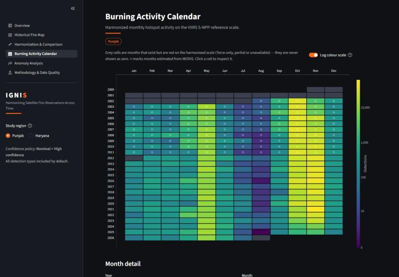
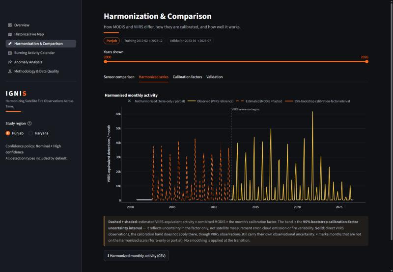
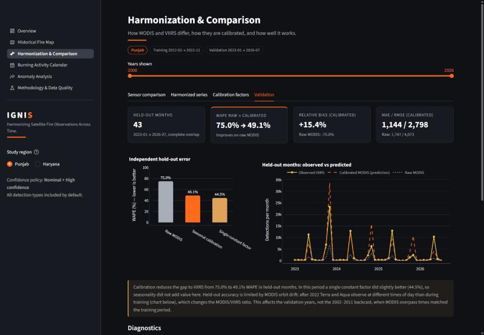

# IGNIS

### Harmonizing Satellite Fire Observations Across Time.

**NASA Space Apps Challenge 2026 — *Harmonization of MODIS and VIIRS Hot Spots***

IGNIS builds a harmonized historical record of satellite hotspot activity for **Punjab** and
**Haryana**, India, from actual NASA FIRMS MODIS and VIIRS archives, and presents it in an
interactive Streamlit web application.


---

## The problem

NASA detects active fires with **MODIS** (Terra since 2000, Aqua since 2002; ~1 km fire pixels)
and **VIIRS** (Suomi-NPP since 2012; ~375 m). VIIRS detects many small fires that MODIS misses,
so raw detection counts jump when VIIRS appears. A rise in raw counts can therefore reflect a
change in instrument rather than more burning, which makes long-term trends hard to read.

## What IGNIS does

IGNIS estimates what the pre-VIIRS MODIS record would look like on the **VIIRS S-NPP reference
scale**, using a seasonal, region-specific calibration learned where both sensors overlap. It
validates that calibration on held-out years, quantifies calibration-factor uncertainty, and
lets users explore the result.

**Objectives**

1. Explore the geography of historical hotspot detections.
2. Compare MODIS and VIIRS observations directly.
3. Read a harmonized month-by-year burning-activity calendar.
4. See seasonal patterns and compare months with their historical baselines.
5. Understand — and download — every processed dataset.

## Features

| Page | What it shows |
|---|---|
| **Overview** | Coverage, MODIS and VIIRS totals, harmonized record, trend, seasonality, detection types, calibration status |
| **Historical Fire Map** | PyDeck map within real state boundaries; date, sensor and detection-type filters; tooltips; 1 km-grid density or individual points |
| **Harmonization & Comparison** | Raw sensor comparison, harmonized series with uncertainty band, Terra/Aqua breakdown, monthly calibration factors, validation, orbit-drift diagnostics |
| **Burning Activity Calendar** | Month × year heatmap of harmonized activity with status for every month; click a month for details or to open it on the map |
| **Anomaly Analysis** | Each month vs. the median of the same calendar month in other years |
| **Methodology & Data Quality** | Data sources, pipeline, formulas, uncertainty, quality report, limitations, all CSV downloads |

A persistent sidebar selector switches every page and export between Punjab and Haryana.

| | |
|---|---|
|  |  |
|  |  |
|  |  |

## NASA datasets

Standard-quality historical archives downloaded from [NASA FIRMS](https://firms.modaps.eosdis.nasa.gov/download/):

| Archive | CSV used | Records | Coverage |
|---|---|---|---|
| `MODIS C6.1.zip` (Terra + Aqua, Collection 6.1) | `fire_archive_M-C61_846942.csv` | 455,872 | 2000-11-01 → 2026-08-27 |
| `SUOMI VIIRS C2.zip` (Suomi-NPP, Collection 2) | `fire_archive_SV-C2_846954.csv` | 1,291,486 | 2012-01-20 → 2026-07-31 |

The near-real-time (`fire_nrt_*`) CSVs inside the ZIPs are ignored. Full source statistics,
including one documented discrepancy with the expected MODIS high/nominal split, are in
[`docs/data_sources.md`](docs/data_sources.md).

**Analytical policies**

- **Confidence:** nominal + high only — MODIS `confidence ≥ 30`, VIIRS `n`/`h`. Low-confidence
  detections are excluded and counted.
- **Detection types:** all types included (0 vegetation fire, 2 other static land source,
  3 offshore). Detections are *hotspot detections*, not confirmed wildfires.
- **Platforms:** Terra and Aqua combined for MODIS (kept separately identifiable); VIIRS uses
  Suomi-NPP only.

## Study area

Punjab and Haryana are analysed independently, using real administrative boundaries from
**geoBoundaries** (India ADM1, CC BY 2.5 IN; DataMeet / Election Commission of India) in
EPSG:4326. Every detection is assigned to Punjab, Haryana or *outside study area* by
point-in-polygon; outside detections (border strip and Chandigarh) are excluded and reported.
The FIRMS request polygon covers 100% of both states.

| Retained (nominal + high, in state) | Terra | Aqua | VIIRS S-NPP |
|---|---|---|---|
| Punjab | 74,938 | 294,548 | 936,691 |
| Haryana | 21,522 | 42,777 | 171,613 |

## Harmonization methodology

For each region and calendar month *m*, over complete overlapping training months
(**Feb 2012 – Dec 2022**):

```
r(y,m) = VIIRS(y,m) / MODIS_combined(y,m)        (both ≥ 5 detections)
r(m)   = median over years of r(y,m)             (needs ≥ 5 valid years)
```

- **Aug 2002 – Dec 2011:** `H = MODIS_combined × r(m)` — *estimated* VIIRS-equivalent activity.
- **Feb 2012 – Jul 2026:** `H = VIIRS` — *observed* reference values.
- Terra-only months (Nov 2000 – Jun 2002), partial months (Jul 2002, Jan 2012) and the
  MODIS-only tail (Aug 2026) are flagged and never placed on the harmonized scale.
- MODIS and VIIRS counts are never added together. Missing observations are never zero.

All 24 region-month factors have enough training years (6–11). Details and formulas:
[`docs/methodology.md`](docs/methodology.md).

## Validation

Factors are fitted on training years only and tested on **Jan 2023 – Jul 2026** (43 complete
months per state). WAPE = total absolute error / total VIIRS:

| Held-out 2023–2026 | Punjab | Haryana |
|---|---|---|
| Raw MODIS vs VIIRS | 75.0% | 81.2% |
| **Seasonal calibration** | **49.1%** (bias +15.4%) | **34.0%** (bias −15.0%) |
| Single constant factor (baseline) | 44.5% | 32.9% |

Calibration clearly improves comparability, but held-out accuracy is limited, and in this period
the seasonal factors did not beat a single constant factor. The cause is visible in the data:
**Terra and Aqua drifted off their original overpass times after 2022** (Aqua ~13:45 → ~15:07 IST
by 2025; Terra ~11:20 → ~10:06 IST), while Suomi-NPP stayed at ~13:40. In the stable-orbit years
the method performs well — a supplementary leave-one-year-out check over 2012–2021 gives
**12.5% (Punjab) and 11.3% (Haryana)** WAPE with near-zero bias, and seasonal factors beat the
constant factor. That check re-uses training-period data and does not replace the independent
hold-out. The 2002–2011 backcast period has MODIS overpass times matching the training years.

## Uncertainty

Estimated months carry a **95% bootstrap calibration-factor uncertainty interval**: the valid
training-year ratios are resampled 2,000 times (seed 42), and the 2.5th/97.5th percentiles of
the resampled medians give `[MODIS × r_lower, MODIS × r_upper]`. This covers calibration-factor
uncertainty only — not satellite measurement error, cloud omission, algorithm uncertainty or
fire variability — and is not a prediction interval. No band is drawn over VIIRS observations,
which still carry their own observational uncertainty.

## Technology

Python · Streamlit · Pandas · NumPy · Plotly · PyDeck · GeoPandas · Shapely · PyArrow · Pytest.
No databases, APIs or ML models. Architecture: [`docs/architecture.md`](docs/architecture.md).

## Getting started

Requires Python 3.11+ (developed on 3.13).

```bash
python -m venv .venv
.venv\Scripts\activate          # Windows  (macOS/Linux: source .venv/bin/activate)
pip install -r requirements.txt
```

**1. Place the NASA archives** (not committed to git) exactly as named:

```
data/raw/incoming/MODIS C6.1.zip
data/raw/incoming/SUOMI VIIRS C2.zip
```

**2. Inspect the archives** (optional; writes `data/processed/inspection_report.json`):

```bash
python -m scripts.inspect_archives
```

**3. State boundaries** are committed in `data/geo/`. To rebuild them from the pinned
geoBoundaries release:

```bash
python -m scripts.prepare_boundaries
```

**4. Run the preprocessing pipeline** (~35 s; writes everything in `data/processed/`):

```bash
python -m scripts.run_pipeline
```

Re-run only calibration/validation/anomalies from the saved monthly totals (~2 s):

```bash
python -m scripts.run_pipeline --skip-ingest
```

**5. Run the tests:**

```bash
pytest -q
```

**6. Launch IGNIS:**

```bash
streamlit run app.py
```

The website only reads precomputed outputs; if they are missing, each page shows the pipeline
command instead of failing.

## Data attribution

- Active-fire data: NASA FIRMS — MODIS Collection 6.1 (MCD14ML) and VIIRS S-NPP 375 m
  Collection 2 (VNP14IMG). We acknowledge the use of data from NASA's Fire Information for
  Resource Management System (FIRMS), part of NASA's Earth Science Data and Information System
  (ESDIS).
- Boundaries: geoBoundaries (Runfola et al. 2020, *PLoS ONE* 15(4): e0231866), India ADM1
  derived from DataMeet / Election Commission of India, CC BY 2.5 IN.
- Basemap: © OpenStreetMap contributors © CARTO.

## Scientific limitations

- Hotspot detections are not unique wildfire events; grid-cell counts are not fire counts.
- MODIS and VIIRS have different detection characteristics; the calibration is a regional,
  empirical adjustment, not a physical conversion.
- VIIRS is a reference instrument, not ground truth.
- Two MODIS satellites are compared with one VIIRS satellite, so the factors also absorb
  differences in observation opportunities.
- Terra/Aqua orbit drift after 2022 reduces MODIS–VIIRS comparability in recent years.
- Uncertainty bands cover only the calibration factor.
- Missing observations are never interpreted as zero fire activity.
- Anomalies describe unusual satellite-detected activity, not emergencies.

---

Developed for the NASA Space Apps Challenge 2026.
