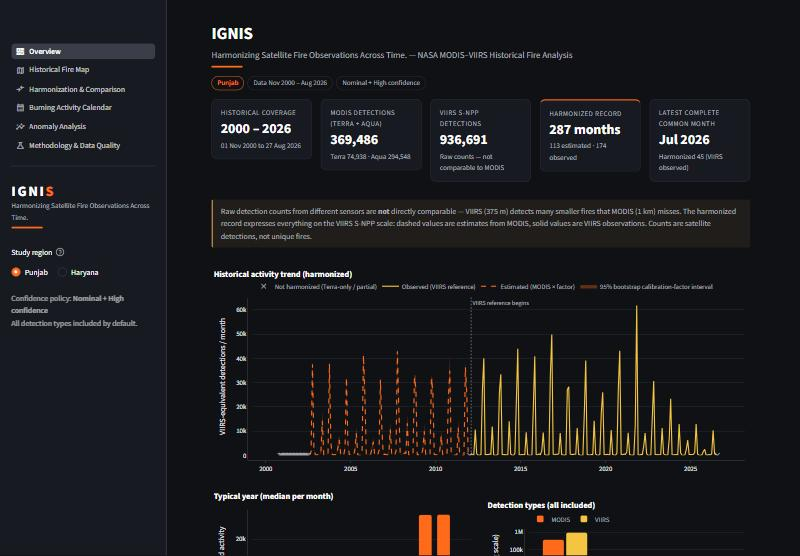
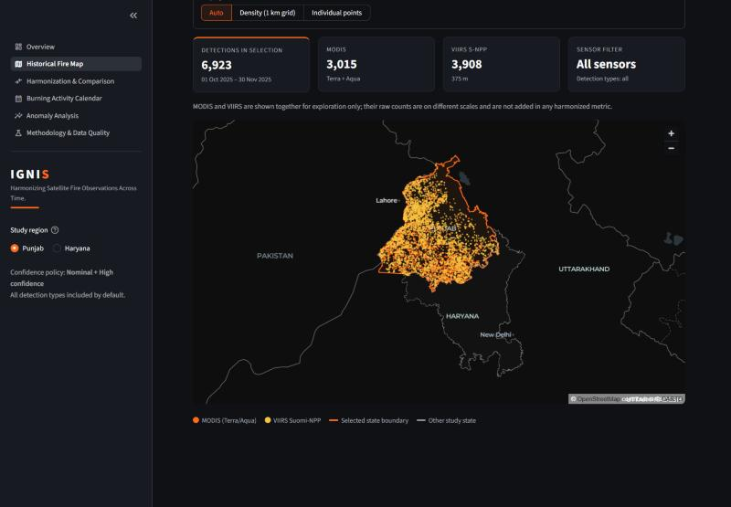
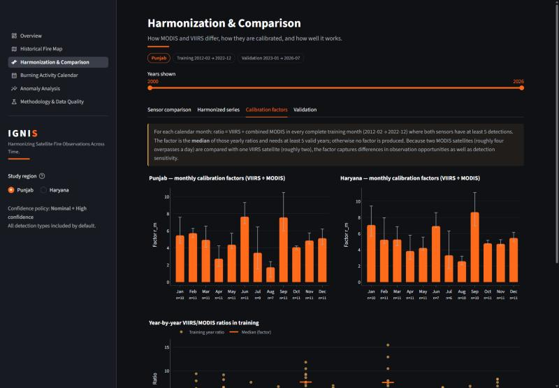
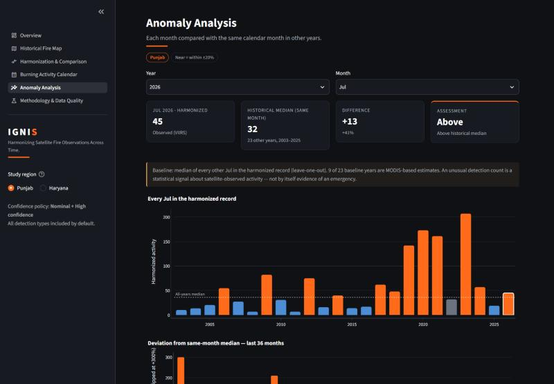

# IGNIS
<<<<<<< HEAD

### Harmonizing Satellite Fire Observations Across Time.

**NASA Space Apps Challenge 2026 — *Harmonization of MODIS and VIIRS Hot Spots***

IGNIS builds a harmonized historical record of satellite hotspot activity for **Punjab** and
**Haryana**, India, from actual NASA FIRMS MODIS and VIIRS archives, and presents it in an
interactive Streamlit web application.



---

## The problem

NASA detects active fires with **MODIS** (Terra since 2000, Aqua since 2002; ~1 km fire pixels)
and **VIIRS** (Suomi-NPP since 2012; ~375 m). VIIRS detects many small fires that MODIS misses,
so raw detection counts jump when VIIRS appears. A rise in raw counts can therefore reflect a
change in instrument rather than more burning, which makes long-term trends hard to read.

## What IGNIS does

IGNIS estimates what the pre-VIIRS MODIS record would look like on the **VIIRS S-NPP reference
scale**, using a seasonal, region-specific calibration learned where both sensors overlap. It
validates that calibration on held-out years, quantifies calibration-factor uncertainty, and
lets users explore the result.

**Objectives**

1. Explore the geography of historical hotspot detections.
2. Compare MODIS and VIIRS observations directly.
3. Read a harmonized month-by-year burning-activity calendar.
4. See seasonal patterns and compare months with their historical baselines.
5. Understand — and download — every processed dataset.

## Features

| Page | What it shows |
|---|---|
| **Overview** | Coverage, MODIS and VIIRS totals, harmonized record, trend, seasonality, detection types, calibration status |
| **Historical Fire Map** | PyDeck map within real state boundaries; date, sensor and detection-type filters; tooltips; 1 km-grid density or individual points |
| **Harmonization & Comparison** | Raw sensor comparison; four-series chart (raw MODIS, actual VIIRS, calibrated MODIS, final harmonized record) with uncertainty band; Terra/Aqua breakdown; monthly calibration factors; validation with error by year and overpass-time diagnostics |
| **Burning Activity Calendar** | Month × year heatmap of harmonized activity with status for every month; click a month for details or to open it on the map |
| **Anomaly Analysis** | Each month vs. the median of the same calendar month in other years |
| **Methodology & Data Quality** | Data sources, pipeline, formulas, uncertainty, quality report, limitations, all CSV downloads |

A top navigation bar links all six pages, and a searchable **Study region** dropdown switches
every page and export between Punjab and Haryana (regions come from `config/regions.py`).

| | |
|---|---|
|  |  |
|  |  |
|  |  |

## NASA datasets

Standard-quality historical archives downloaded from [NASA FIRMS](https://firms.modaps.eosdis.nasa.gov/download/):

| Archive | CSV used | Records | Coverage |
|---|---|---|---|
| `MODIS C6.1.zip` (Terra + Aqua, Collection 6.1) | `fire_archive_M-C61_846942.csv` | 455,872 | 2000-11-01 → 2026-08-27 |
| `SUOMI VIIRS C2.zip` (Suomi-NPP, Collection 2) | `fire_archive_SV-C2_846954.csv` | 1,291,486 | 2012-01-20 → 2026-07-31 |

The near-real-time (`fire_nrt_*`) CSVs inside the ZIPs are ignored. Full source statistics,
including one documented discrepancy with the expected MODIS high/nominal split, are in
[`docs/data_sources.md`](docs/data_sources.md).

**Analytical policies**

- **Confidence:** nominal + high only — MODIS `confidence ≥ 30`, VIIRS `n`/`h`. Low-confidence
  detections are excluded and counted.
- **Detection types:** all types included (0 vegetation fire, 2 other static land source,
  3 offshore). Detections are *hotspot detections*, not confirmed wildfires.
- **Platforms:** Terra and Aqua combined for MODIS (kept separately identifiable); VIIRS uses
  Suomi-NPP only.

## Study area

Punjab and Haryana are analysed independently, using real administrative boundaries from
**geoBoundaries** (India ADM1, CC BY 2.5 IN; DataMeet / Election Commission of India) in
EPSG:4326. Every detection is assigned to Punjab, Haryana or *outside study area* by
point-in-polygon; outside detections (border strip and Chandigarh) are excluded and reported.
The FIRMS request polygon covers 100% of both states.

| Retained (nominal + high, in state) | Terra | Aqua | VIIRS S-NPP |
|---|---|---|---|
| Punjab | 74,938 | 294,548 | 936,691 |
| Haryana | 21,522 | 42,777 | 171,613 |

## Harmonization methodology

For each region and calendar month *m*, over complete overlapping training months
(**Feb 2012 – Dec 2022**):

```
r(y,m) = VIIRS(y,m) / MODIS_combined(y,m)        (both ≥ 5 detections)
r(m)   = median over years of r(y,m)             (needs ≥ 5 valid years)
```

- **Aug 2002 – Dec 2011:** `H = MODIS_combined × r(m)` — *estimated* VIIRS-equivalent activity.
- **Feb 2012 – Jul 2026:** `H = VIIRS` — *observed* reference values.
- Terra-only months (Nov 2000 – Jun 2002), partial months (Jul 2002, Jan 2012) and the
  MODIS-only tail (Aug 2026) are flagged and never placed on the harmonized scale.
- MODIS and VIIRS counts are never added together. Missing observations are never zero.

All 24 region-month factors have enough training years (6–11). Details and formulas:
[`docs/methodology.md`](docs/methodology.md).

## Validation

Factors are fitted on training years only and tested on **Jan 2023 – Jul 2026** (43 complete
months per state). WAPE = total absolute error / total VIIRS:

| Held-out 2023–2026 | Punjab | Haryana |
|---|---|---|
| Raw MODIS vs VIIRS | 75.0% | 81.2% |
| **Seasonal calibration** | **49.1%** (bias +15.4%) | **34.0%** (bias −15.0%) |
| Single constant factor (baseline) | 44.5% | 32.9% |

Calibration clearly improves comparability, but held-out accuracy is limited, and in this period
the seasonal factors did not beat a single constant factor.

**Calibrated MODIS series.** The same formula, `MODIS × r(region, month)`, is also applied to every
complete MODIS month as a separate comparison series (`calibrated_modis_monthly.csv`), using the
training factors unchanged. It is in-sample for Feb 2012 – Dec 2022 and out-of-sample for
Jan 2023 – Jul 2026; the final harmonized record still uses actual VIIRS wherever it exists.

| Calibrated MODIS vs VIIRS (WAPE) | Punjab | Haryana |
|---|---|---|
| Training years, in-sample (each year) | 10.5% (6.9–15.8%) | 10.3% (3.8–15.4%) |
| Held-out 2023 – Jul 2026, out-of-sample | 49.1% | 34.0% |

**Does performance change after 2022?** Yes — error is within ~16% in every training year,
including 2022, and rises from 2023. This coincides with Terra and Aqua drifting off their original
overpass times (Aqua ~13:45 → ~15:07 IST by 2025; Terra ~11:20 → ~10:06 IST; Suomi-NPP steady at
~13:40) and with changes in burning itself (e.g. Punjab's falling stubble-burning detections). The
data show *when* agreement changes but cannot attribute it to one cause, and MODIS detections remain
valid observations. A supplementary leave-one-year-out check over 2012–2021 gives **12.5% (Punjab)
and 11.3% (Haryana)** WAPE; it re-uses training-period data and does not replace the independent
hold-out. The 2002–2011 backcast period has MODIS overpass times matching the training years.

## Uncertainty

Estimated months carry a **95% bootstrap calibration-factor uncertainty interval**: the valid
training-year ratios are resampled 2,000 times (seed 42), and the 2.5th/97.5th percentiles of
the resampled medians give `[MODIS × r_lower, MODIS × r_upper]`. This covers calibration-factor
uncertainty only — not satellite measurement error, cloud omission, algorithm uncertainty or
fire variability — and is not a prediction interval. No band is drawn over VIIRS observations,
which still carry their own observational uncertainty.

## Technology

Python · Streamlit · Pandas · NumPy · Plotly · PyDeck · GeoPandas · Shapely · PyArrow · Pytest.
No databases, APIs or ML models. Architecture: [`docs/architecture.md`](docs/architecture.md).

## Getting started

Requires Python 3.11+ (developed on 3.13).

```bash
python -m venv .venv
.venv\Scripts\activate          # Windows  (macOS/Linux: source .venv/bin/activate)
pip install -r requirements.txt
```

**Just want to run the website?** All processed outputs the app needs are committed —
including the compact map data `data/processed/map_detections.parquet` — so after cloning
you can skip straight to step 6. After every `git pull`, re-run
`pip install -r requirements.txt` and restart Streamlit so your packages match the code.

**1. Place the NASA archives** (not committed to git; only needed to re-run the pipeline)
exactly as named:

```
data/raw/incoming/MODIS C6.1.zip
data/raw/incoming/SUOMI VIIRS C2.zip
```

**2. Inspect the archives** (optional; writes `data/processed/inspection_report.json`):

```bash
python -m scripts.inspect_archives
```

**3. State boundaries** are committed in `data/geo/`. To rebuild them from the pinned
geoBoundaries release:

```bash
python -m scripts.prepare_boundaries
```

**4. Run the preprocessing pipeline** (~35 s; writes everything in `data/processed/`):

```bash
python -m scripts.run_pipeline
```

Re-run only calibration/validation/anomalies from the saved monthly totals (~2 s):

```bash
python -m scripts.run_pipeline --skip-ingest
```

**5. Run the tests:**

```bash
pytest -q
```

**6. Launch IGNIS:**

```bash
streamlit run app.py
```

The website only reads precomputed outputs; if they are missing, each page shows the pipeline
command instead of failing.

## Data attribution

- Active-fire data: NASA FIRMS — MODIS Collection 6.1 (MCD14ML) and VIIRS S-NPP 375 m
  Collection 2 (VNP14IMG). We acknowledge the use of data from NASA's Fire Information for
  Resource Management System (FIRMS), part of NASA's Earth Science Data and Information System
  (ESDIS).
- Boundaries: geoBoundaries (Runfola et al. 2020, *PLoS ONE* 15(4): e0231866), India ADM1
  derived from DataMeet / Election Commission of India, CC BY 2.5 IN.
- Basemap: © OpenStreetMap contributors © CARTO.

## Scientific limitations

- Hotspot detections are not unique wildfire events; grid-cell counts are not fire counts.
- MODIS and VIIRS have different detection characteristics; the calibration is a regional,
  empirical adjustment, not a physical conversion.
- VIIRS is a reference instrument, not ground truth.
- Two MODIS satellites are compared with one VIIRS satellite, so the factors also absorb
  differences in observation opportunities.
- Terra/Aqua overpass times changed after 2021 and calibrated MODIS agrees less well with VIIRS
  from 2023; the drift is a possible contributor that IGNIS evaluates rather than assumes.
- Uncertainty bands cover only the calibration factor.
- Missing observations are never interpreted as zero fire activity.
- Anomalies describe unusual satellite-detected activity, not emergencies.

---

Developed for the NASA Space Apps Challenge 2026.
=======
### Harmonizing Satellite Fire Observations Across Time

**Live Website:** https://ignisearth.wiki

IGNIS is a satellite fire-data harmonization and visualization platform developed for the **NASA Space Apps Challenge 2026**. It addresses the inconsistencies between MODIS and VIIRS satellite observations to make historical hotspot activity more comparable across time.

## Overview

Different satellite sensors detect fires at different spatial resolutions and with different detection capabilities. Consequently, changes in recorded hotspot counts do not necessarily represent actual changes in fire activity.

IGNIS addresses this problem by harmonizing historical MODIS observations against VIIRS reference observations, creating a more consistent historical record for analysis.

The platform focuses on **Punjab and Haryana, India**, with independent regional selection.

## Key Features

- **Historical Fire Map:** Geographical visualization of satellite hotspot detections across Punjab and Haryana.
- **Harmonization & Comparison:** Compare raw MODIS observations, VIIRS observations and calibrated MODIS estimates.
- **Burning Activity Calendar:** Explore monthly hotspot activity through a year-by-year heatmap.
- **Anomaly Analysis:** Identify months with unusually high or low detection activity relative to historical seasonal patterns.
- **Historical Trends:** Examine long-term changes in satellite-observed hotspot activity.
- **Methodology & Data Quality:** Explore sensor characteristics, confidence filtering, data coverage, calibration methodology and limitations.

## Data Sources

IGNIS uses historical satellite active-fire archives from **NASA FIRMS (Fire Information for Resource Management System)**.

| Satellite sensor | Dataset | Coverage |
|---|---|---|
| MODIS | Collection 6.1 (Terra + Aqua) | 2000–2026 |
| VIIRS | Suomi-NPP Collection 2 | 2012–2026 |

Both datasets are standardized and processed to enable regional and monthly comparisons.

## Harmonization Methodology

IGNIS uses an empirical calibration approach to account for differences in detection counts between MODIS and VIIRS.

The calibration process:

1. Standardizes observations from both satellite datasets.
2. Aggregates hotspot detections by region and calendar month.
3. Compares MODIS and VIIRS observations during their overlapping period.
4. Calculates monthly calibration factors using the median of year-specific VIIRS-to-MODIS ratios.
5. Applies these factors to historical MODIS observations to estimate activity on the VIIRS reference scale.


The calibration factor is:

$$
r_m = \mathrm{median}_{y}
\left(
\frac{VIIRS_{y,m}}{MODIS_{y,m}}
\right)
$$

The harmonized estimate is:

$$
H_{y,m} = MODIS_{y,m} \times r_m
$$


Calibration factors are trained using February 2012–December 2022 and independently evaluated against January 2023–July 2026 observations.

The final harmonized record uses calibrated MODIS estimates for the pre-VIIRS period and actual VIIRS observations from February 2012 onward.

## Technology Stack

- **Language:** Python
- **Application:** Streamlit
- **Data Processing:** Pandas, NumPy, GeoPandas, PyArrow
- **Geospatial Analysis:** Shapely
- **Visualization:** Plotly, PyDeck
- **Testing:** Pytest

## Data Interpretation & Limitations

- Hotspot detections represent satellite-observed thermal anomalies, not unique fires or confirmed wildfire incidents.
- MODIS and VIIRS have different spatial resolutions and detection characteristics.
- Harmonization improves historical comparability but does not make the sensors identical.
- Calibration is empirical and specific to the selected regions and datasets.
- Calibration uncertainty is considered for historical estimates.
- Partial observation months are identified separately to avoid misleading comparisons.
- Only historical archive data is included; near-real-time monitoring is outside the current project scope.


## License

The IGNIS source code is licensed under the **MIT License**. See the [LICENSE](LICENSE) file for details.

Third-party datasets, including NASA FIRMS satellite observations, remain subject to their respective terms of use and attribution requirements.

---

*IGNIS aims to make long-term satellite fire observations more consistent, interpretable and useful for historical analysis.*
>>>>>>> 398ae2ebb76ff5f8e2778bebf4e4de063c8316c0
